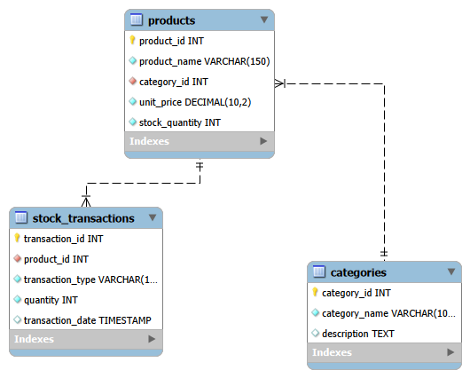

# Warehouse Management Database Project

## Project Overview
This database system is designed for managing warehouse inventory, category cataloging, and stock transactions using MySQL.

## Database Name
`mustafa_202512507_warehouse_mgmt`

## Entity Relationship Diagram (ERD)
The database structure consists of three main tables:
1. `categories` (Parent Table)
2. `products` (Child Table linked to categories)
3. `stock_transactions` (Child Table linked to products)



## Repository Structure
- `assignment_iii.sql`: Complete SQL script including table creation, initial data, and JOIN queries.
- `erd.png`: Entity Relationship Diagram image.
- `README.md`: Project documentation file.
- ### Task: Inner Join Query
```sql
SELECT t.transaction_id, p.product_name, t.transaction_type, t.quantity, t.transaction_date
FROM stock_transactions t
JOIN products p ON t.product_id = p.product_id;
```

